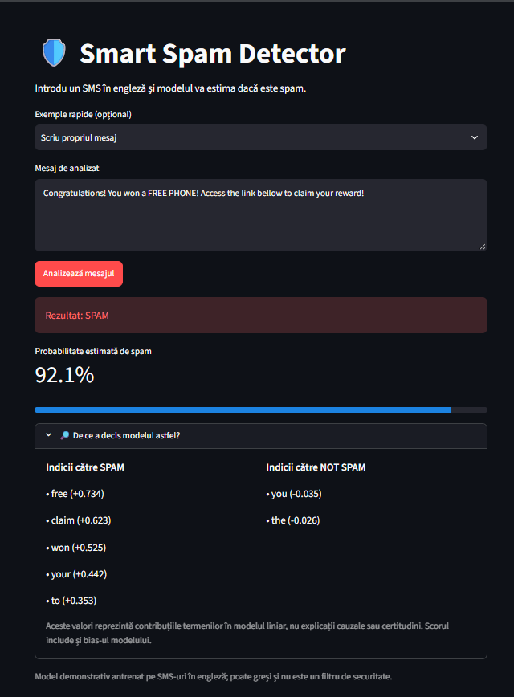

# 🛡️ Smart Spam Detector

**An explainable SMS spam classifier built with Python, scikit-learn and Streamlit.**

[**🚀 Try the live demo**](https://ai-spam-detector-df3arof2loyabguty9ipr2.streamlit.app/) · [**📸 Screenshot**](assets/screenshot.png) · [**📊 Model evaluation**](docs/model-evaluation.md)

[](https://github.com/Ionut255/AI-spam-detector/actions/workflows/tests.yml)

This project classifies English-language SMS messages as **SPAM** or **NOT SPAM**, displays an estimated spam probability, and explains which text features influenced the prediction.

> **Status:** Live demo deployed on Streamlit Community Cloud. The model is trained on English-language SMS data, so predictions on full emails, other languages, or unfamiliar spam patterns may be unreliable. Do not use this demo as the sole security filter.

## Portfolio highlights

- **End-to-end ML workflow:** dataset acquisition, deduplication, train/test split, feature extraction, modeling, evaluation, and deployment.
- **Model selection:** compared Logistic Regression against Multinomial Naive Bayes on the same held-out split.
- **Explainability:** displays feature contributions from the selected linear model; results are not causal explanations.
- **Deployment and tests:** public Streamlit app and automated GitHub Actions checks.

## Features

- Classifies text using **TF-IDF + Logistic Regression**.
- Shows a predicted label and estimated spam probability.
- Explains influential terms for each prediction using the linear model's feature contributions.
- Includes a second baseline (**Multinomial Naive Bayes**) for model comparison.
- Evaluates model quality using accuracy, precision, recall, F1-score and a confusion matrix.
- Includes an automated test for the training pipeline.

## Model results

Both models were evaluated on the same held-out test set (**1,035 SMS messages**, 20% of the deduplicated dataset). Scores are rounded to three decimals.

| Metric (spam = positive class) | Logistic Regression | Multinomial Naive Bayes |
|---|---:|---:|
| Accuracy | **0.979** | 0.968 |
| Precision | 0.916 | **1.000** |
| Recall | **0.916** | 0.748 |
| F1-score | **0.916** | 0.856 |

**Selected model: Logistic Regression.** It has higher recall and F1-score, detecting **120 of 131** spam messages in the held-out set. The confusion matrix for Logistic Regression is:

| Actual \\ Predicted | NOT SPAM | SPAM |
|---|---:|---:|
| NOT SPAM | 893 | 11 |
| SPAM | 11 | 120 |

Multinomial Naive Bayes made no false-positive spam predictions on this particular test set (precision 1.000), but missed considerably more spam. The choice depends on the costs of false positives versus false negatives. The results are specific to this split and should not be treated as production guarantees.

More details: [Evaluation notes](docs/model-evaluation.md).

## How it works

```text
English SMS message
        ↓
TF-IDF vectorizer (unigrams and bigrams)
        ↓
Logistic Regression classifier
        ↓
SPAM / NOT SPAM + estimated score
        ↓
Top positive and negative token contributions
```

## Run locally (Windows / PowerShell)

**Prerequisites:** Python and Git installed, VS Code optional. Open a terminal in the project folder.

```powershell
python -m venv .venv
.\.venv\Scripts\python.exe -m pip install -r requirements.txt
.\.venv\Scripts\python.exe -m streamlit run app.py
```

Open the local URL displayed by Streamlit, usually `http://localhost:8501`.

At first launch, the app automatically downloads the [SMS Spam Collection dataset](https://archive.ics.uci.edu/dataset/228/sms+spam+collection) and trains the model if `model/spam_pipeline.joblib` is missing. The fitted model, raw dataset and virtual environment are excluded from Git.

To train and **print evaluation metrics** explicitly, run:

```powershell
.\.venv\Scripts\python.exe train_model.py
```

If the dataset download fails, extract `SMSSpamCollection` manually into `data/` and rerun the training script.

### Run tests

```powershell
.\.venv\Scripts\python.exe -m pytest -q
```

GitHub Actions also runs the tests automatically on pushes and pull requests.

## Project structure

```text
smart-spam-detector/
├── app.py                     # Streamlit UI and feature explanations
├── train_model.py             # Dataset, preprocessing, model training and evaluation
├── requirements.txt           # Python dependencies
├── tests/test_model.py        # Automated pipeline test
├── docs/model-evaluation.md   # Comparison, error analysis and limitations
├── assets/                    # Optional screenshot(s)
├── .github/workflows/tests.yml # GitHub Actions test workflow
├── data/                      # Downloaded training data (not committed)
└── model/                     # Trained model artifact (not committed)
```

## Deploy on Streamlit Community Cloud

1. Open [share.streamlit.io](https://share.streamlit.io/) and sign in with GitHub.
2. Choose **Create app** → **Deploy a public app from GitHub** (wording may vary).
3. Select repository `Ionut255/AI-spam-detector`, branch `main`, and main file `app.py`.
4. In the advanced settings, select **Python 3.13** if available.
5. Deploy and wait for the first startup. On a new server, the app downloads the UCI SMS dataset, trains the classifier, and saves `model/spam_pipeline.joblib` locally. This may take longer than subsequent starts.
6. If startup fails, review the app's **Manage app → Logs** for dataset/network or dependency errors.

Cloud containers may restart or reset; the model will train again if its local artifact is missing. No external secrets are required for this public dataset.

## Screenshot



## Data and attribution

[UCI Machine Learning Repository — SMS Spam Collection](https://archive.ics.uci.edu/dataset/228/sms+spam+collection), originally 5,574 labeled English-language SMS messages. The training script removes duplicate message texts before splitting into training and test sets.

Associated publication: Almeida, T. A., Gómez Hidalgo, J. M., & Yamakami, A. (2011). *Contributions to the study of SMS spam filtering: new collection and results.*

## Limitations and next steps

- **Language/domain:** The dataset consists of English SMS messages; other languages and email content were not tested.
- **Probability:** Scores are model outputs, not guaranteed calibrated probabilities. Calibration should be checked before relying on a decision threshold.
- **Explanations:** Token contributions are associations within a linear classifier, not causal explanations.
- **Reproducibility:** Scores depend on the dataset version, preprocessing, train/test split and model configuration.
- **Cloud deployment:** The app trains the model when its artifact is missing. This depends on access to the UCI dataset on first startup, and startup times will vary.

Potential improvements: cross-validation, threshold tuning to control false positives, probability calibration, and broader dataset evaluation.

## Author

Built as a practical machine-learning portfolio project by [Ionut255](https://github.com/Ionut255).
